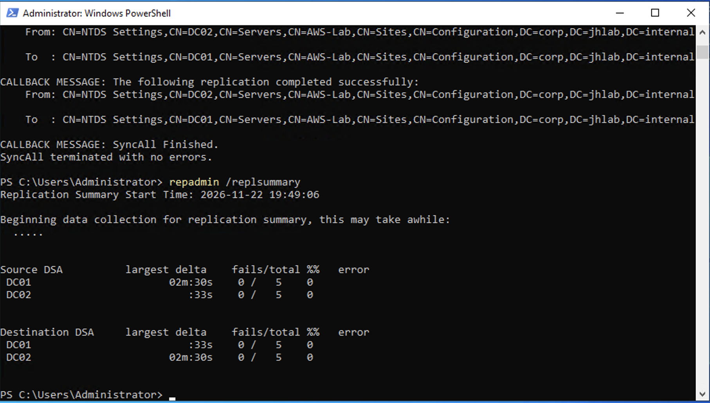

# Pre-flight: Expired Password and Replication Error 8524

**Date:** 2026-11-22
**Context:** Baseline health check before starting the break/fix scenarios, after the lab had been powered off for about a week.

These were not planned scenarios. Both issues came up while bringing the lab back online, so I troubleshot and documented them the same way as the planned ones.

---

## Incident 1: Expired domain Administrator password

### Symptom
- RDP sign-in to DC01 as `JHLAB\Administrator` returned **"Your password has expired and must be changed."**
- The change-password attempt then failed with **"The user name or password is incorrect"**, even though the current password was correct.

### Investigation
- The domain Administrator password was set during the Phase 1 build. The Default Domain Policy's maximum password age is **42 days** (the Windows default), and no fine-grained password policy applies to this account, so the password reached its maximum age.
- The change-password screen showed **"Caps Lock is on."** Caps Lock inverts the case of every letter, so a mixed-case password fails every time, and so does the new password.
- The username format was not the problem: `corp.jhlab.internal\Administrator` and `JHLAB\Administrator` are the same account.

### Root cause
1. The password reached the domain's 42-day maximum password age.
2. Caps Lock was on during the change, so the correct password was being typed in the wrong case.

### Fix
- Toggled Caps Lock until the warning disappeared (the Mac and the remote session can get out of step).
- Used the reveal (eye) icon to check each field before submitting, to avoid reaching the account lockout threshold with repeated bad attempts.
- Changed the password at the sign-in screen, then updated the password manager and the saved credentials in Windows App.

### Verification
```powershell
Get-ADUser Administrator -Properties PasswordLastSet, 'msDS-UserPasswordExpiryTimeComputed' |
  Select-Object Name, PasswordLastSet, @{n='Expires';e={[datetime]::FromFileTime($_.'msDS-UserPasswordExpiryTimeComputed')}}
```
| Name | PasswordLastSet | Expires |
|---|---|---|
| Administrator | 11/22/2026 7:39 PM | 1/3/2027 7:39 PM |

The new expiry is exactly 42 days out, which confirms the Default Domain Policy is the policy in effect.

---

## Incident 2: Replication error 8524 after a week offline

### Symptom
`repadmin /replsummary` on DC01:

| Source DSA | Largest delta | Fails/Total | Error |
|---|---|---|---|
| DC01 | 06d.19h:34m | 1 / 5 | (8524) DNS lookup failure |
| DC02 | 06d.19h:34m | 1 / 5 | (8524) DNS lookup failure |

The destination table showed the same failure for both DCs.

### Investigation
- **Largest delta (about 6 days 19 hours)** matched the time the lab was powered off. That alone is expected; it resets after the next successful sync.
- **Error 8524** means the destination DC could not resolve its replication partner in DNS (the partner's GUID-based CNAME under `_msdcs`).
- Both DCs had booted at the same time, and each uses its partner as its preferred DNS server. My hypothesis was a startup timing problem: replication was attempted before the partner's DNS service was answering. If so, a forced sync would clear it.

### Fix and verification
**Step 1:** On DC01, ran `repadmin /syncall /AdeP`
(`A` = all partitions, `d` = identify servers by DN, `e` = across sites, `P` = push).

- Result: **DC01 → DC02 cleared** (0 / 5, delta 26s). **DC02 → DC01 still showed 8524.**
- Why: `/P` pushes changes *from* the DC it runs on, so only DC01's outbound direction was retried.

**Step 2:** Ran `repadmin /syncall DC02 /AdeP` to run the sync as DC02 and push DC02 → DC01.

Final `repadmin /replsummary`:

| Source DSA | Largest delta | Fails/Total |
|---|---|---|
| DC01 | 02m:30s | 0 / 5 |
| DC02 | :33s | 0 / 5 |

### Root cause
A transient startup timing problem. Both DCs came online together and attempted replication before their partner's DNS was available. No configuration change was needed. If the error had continued, the next checks would have been `Resolve-DnsName DC02.corp.jhlab.internal`, the DC's DNS client settings, and `dcdiag /test:dns`.

---

## Lessons learned
- **Always baseline before you break.** If I had skipped the health check, this replication error would have been mixed into the first scenario's results.
- **Read `repadmin` by direction.** Fixing one direction does not fix the other.
- **Passwords expire in labs too.** Track the expiry date, and update saved credentials after every change so they don't cause a lockout.
- **Check Caps Lock first** whenever a "correct" password is rejected.

## Interview answers
**"A user says their password is correct, but they can't sign in."**
> I check the account state first: is it expired, locked out or disabled? Then I check the simple causes, like Caps Lock or the keyboard layout, before assuming anything is wrong with AD. In my lab, both were true at once: the password had reached the 42-day max age, and Caps Lock was inverting every character during the change.

**"You see error 8524 in repadmin. What do you do?"**
> 8524 means a DC can't resolve its replication partner in DNS. I first check whether it's transient, for example after a reboot, by forcing a sync in both directions with `repadmin /syncall`. If it continues, I check the DC's DNS client settings, confirm the partner's records exist in `_msdcs`, and run `dcdiag /test:dns`.

## Screenshot

