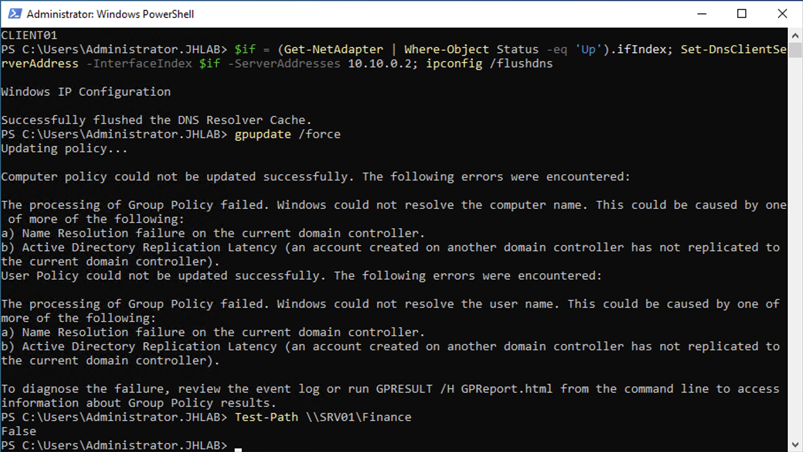
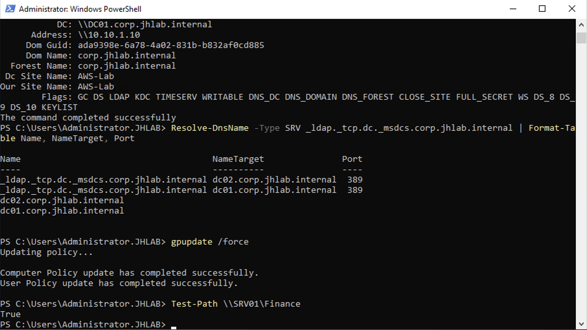

# D1: Client Pointed at the Wrong DNS Server

**Category:** DNS & domain join
**Affected host:** CLIENT01
**Date:** 2026-11-22

## Break
Hard-coded CLIENT01's DNS server to the AWS VPC resolver instead of the domain controllers:
```powershell
$if = (Get-NetAdapter | Where-Object Status -eq 'Up').ifIndex
Set-DnsClientServerAddress -InterfaceIndex $if -ServerAddresses 10.10.0.2
ipconfig /flushdns
```
This simulates a common real-world mistake: someone sets a public or ISP DNS server on a domain-joined machine.

## Symptom
- `gpupdate /force` failed and pointed to the event log and `GPRESULT` for details.
- `Test-Path \\SRV01\Finance` returned **False**.
- Internet name resolution would still work, which is what makes this fault easy to miss.

## Investigation
| Command | Result | What it told me |
|---|---|---|
| `ipconfig /all \| Select-String 'DNS Servers'` | `10.10.0.2` | The client is asking the AWS resolver, not a DC |
| `nltest /dsgetdc:corp.jhlab.internal` | Returned DC01, "completed successfully" | **Misleading:** this answer came from the Netlogon cache |
| `Resolve-DnsName -Type SRV _ldap._tcp.dc._msdcs.corp.jhlab.internal` | `DNS name does not exist` | The client can't find the SRV records that locate DCs |
| `nltest /dsgetdc:corp.jhlab.internal /force` | `1355 ERROR_NO_SUCH_DOMAIN` | With the cache bypassed, the client **cannot** find a DC |

**Key lesson:** the first `nltest` result contradicted every other piece of evidence. The Netlogon service caches the last DC it found, so `/force` is needed to get a live answer.

## Root cause
`corp.jhlab.internal` is an AD-integrated zone hosted only on DC01 and DC02. The AWS VPC resolver (10.10.0.2) has no copy of that zone and no rule forwarding it to the DCs. Forwarding only goes one way: the DCs forward unknown names *to* 10.10.0.2, but 10.10.0.2 never sends queries back to the DCs.

Without the `_ldap._tcp.dc._msdcs` SRV records, the client can't locate a domain controller, so Group Policy, Kerberos authentication and access to file shares by name all fail.

## Fix
```powershell
$if = (Get-NetAdapter | Where-Object Status -eq 'Up').ifIndex
Set-DnsClientServerAddress -InterfaceIndex $if -ResetServerAddresses
ipconfig /flushdns
ipconfig /registerdns
```
- `-ResetServerAddresses` removes the hard-coded entry and returns to DHCP. The VPC's DHCP option set hands out both DC IPs.
- `/flushdns` clears cached negative answers ("name does not exist"), which would otherwise keep failing for a few minutes.
- `/registerdns` re-registers the client's own record with the DCs.

**Why reset to DHCP instead of typing in the DC IPs:** the DHCP option set is the single source of truth. Hard-coding even the *correct* IPs creates the next problem when a DC's IP changes.

## Verification
| Check | Result |
|---|---|
| DNS servers | `10.10.1.10`, `10.10.1.11` |
| `nltest /dsgetdc:corp.jhlab.internal /force` | DC01 found, completed successfully |
| SRV lookup | `dc01` and `dc02`, port 389 |
| `gpupdate /force` | Computer and User Policy completed successfully |
| `Test-Path \\SRV01\Finance` | **True** |

## Prevention
- Hand out DNS through DHCP (here, the VPC DHCP option set) instead of setting it on each client.
- Use Group Policy or configuration management to flag clients with non-domain DNS servers.
- If a non-AD resolver needs to answer for the AD domain, create a conditional forwarder or resolver rule that points `corp.jhlab.internal` at the DCs.

## Interview answer
**"A domain-joined PC can browse the internet, but Group Policy fails and it can't reach file shares. What's wrong?"**
> I'd check its DNS servers first. Domain members must use the domain's DNS, because clients find DCs through SRV records that only exist in the AD-integrated zone. If the client points at a public or cloud resolver, internet names still resolve but DC location fails. I confirm with `nltest /dsgetdc:<domain> /force`, using `/force` to skip the Netlogon cache, and a `Resolve-DnsName` SRV lookup. The fix is to point the client back at the domain DNS servers, ideally through DHCP, then flush the DNS cache.

## Screenshots
**Symptom:**


**Fixed:**

