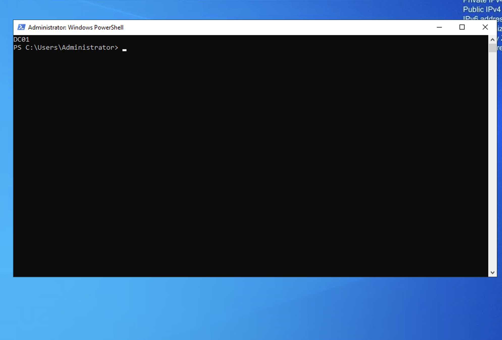
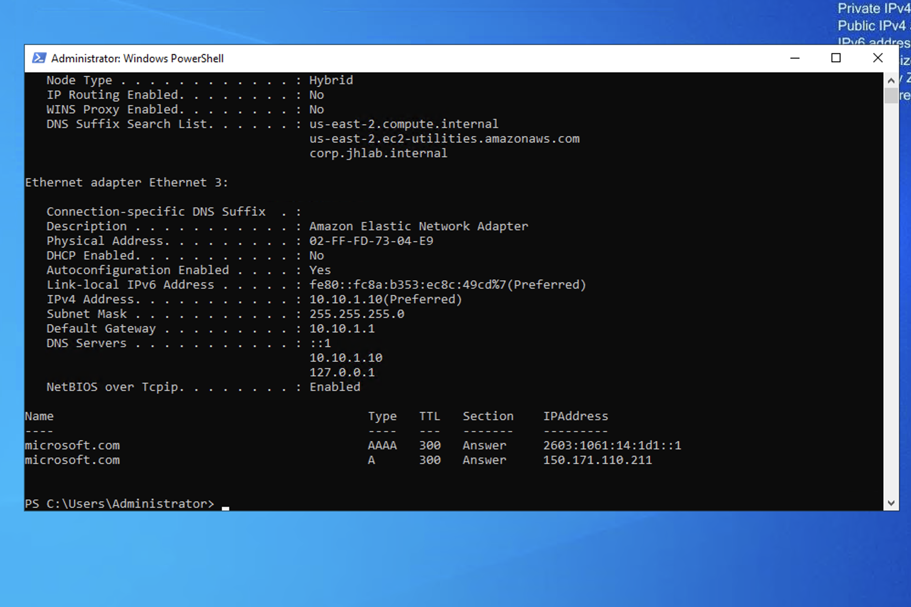
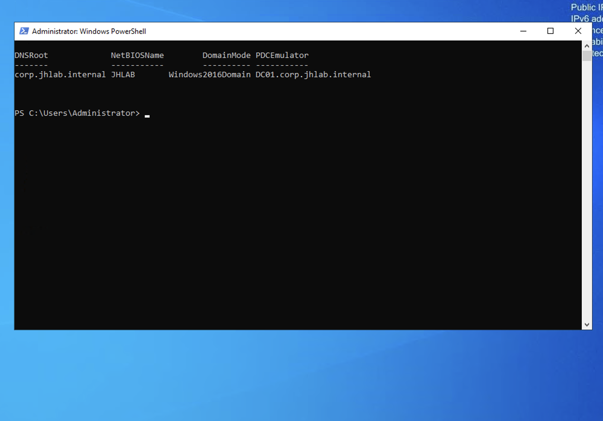
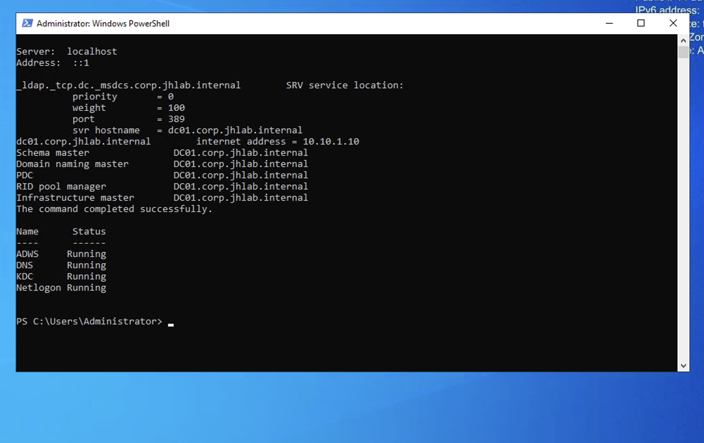
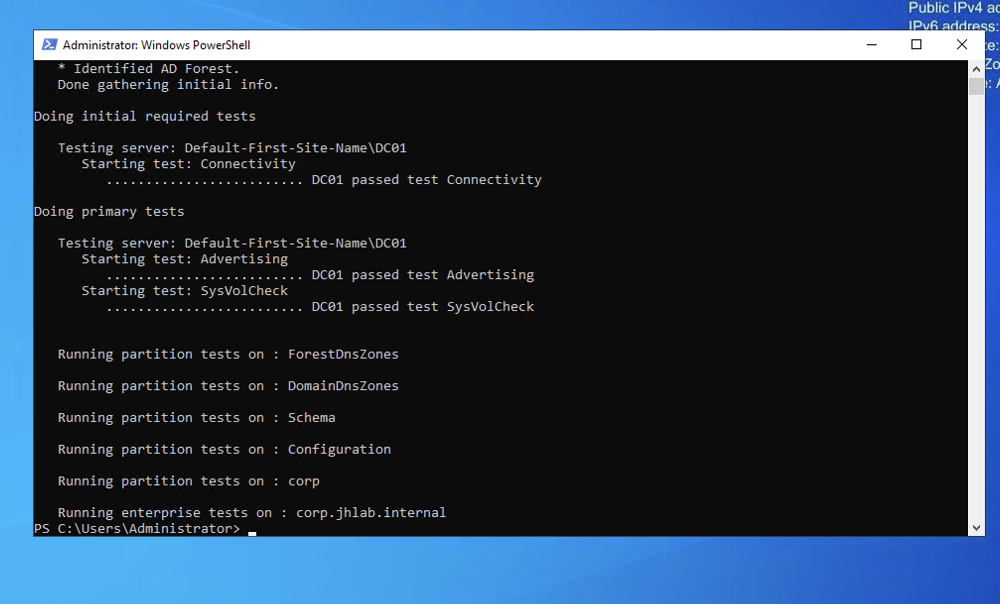

# Phase 1: Build DC01 and the corp.jhlab.internal forest

**Result:** DC01 (10.10.1.10) is the first domain controller of `corp.jhlab.internal` (NetBIOS `JHLAB`), running AD-integrated DNS and acting as the domain time source.

## Steps
1. Renamed the EC2 instance to `DC01` (`Rename-Computer`) before promotion, since a DC's name is written into DNS and replication metadata.
2. Converted the AWS-assigned address to a static IP (10.10.1.10/24, gateway 10.10.1.1) in a single command, so the RDP session could not drop mid-change.
3. Installed AD DS and promoted DC01 with `Install-ADDSForest`, creating the forest, DNS zones, and SYSVOL.
4. Set DNS client to 10.10.1.10 / 127.0.0.1, a forwarder to the AWS resolver (10.10.0.2), and a reverse lookup zone for 10.10.1.0/24.
5. Configured DC01 (PDC emulator) to sync time from Amazon Time Sync (169.254.169.123).

## Verification
- ADWS, DNS, KDC, Netlogon running
- `_ldap._tcp.dc._msdcs` SRV record resolves to dc01 on port 389
- `netdom query fsmo`: DC01 holds all five FSMO roles
- `dcdiag /test:sysvolcheck /test:advertising`: passed

## Issue investigated
`dcdiag /q` reported a failed **DFSREvent** test after promotion. The DFS Replication log showed a single 6016 warning (error 1355, domain not reachable) logged while AD was still starting, followed by 4602 (SYSVOL initialized) and 6018 (configuration updated successfully). SYSVOL and NETLOGON were shared and SysVolCheck passed, so the warning was boot-time noise rather than a replication fault. The test clears once the event ages past 24 hours.

## Screenshots

