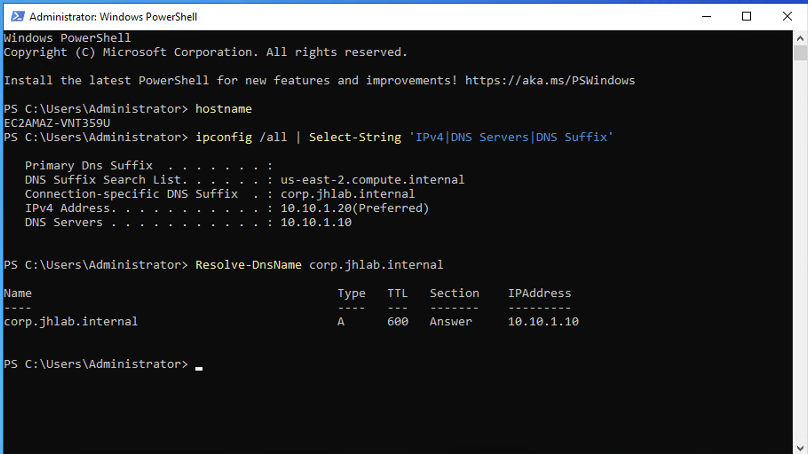
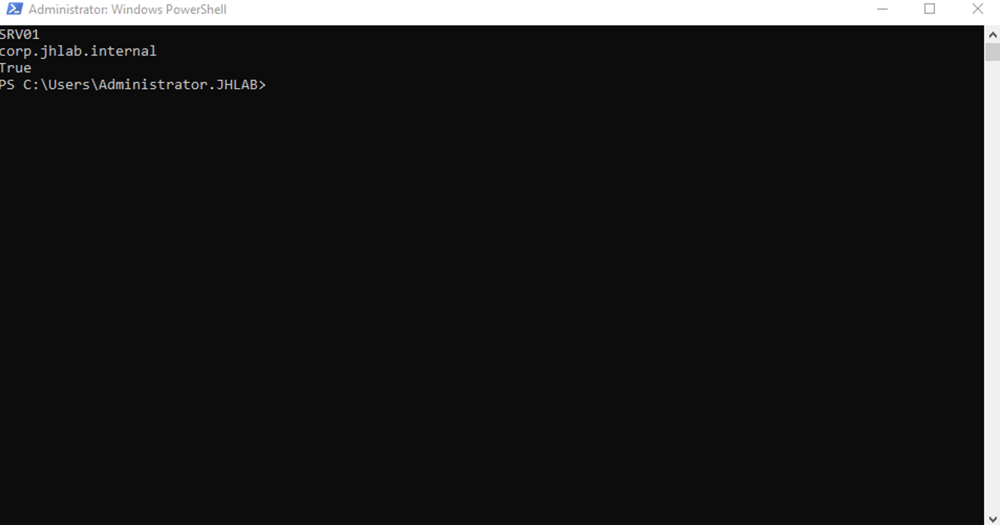
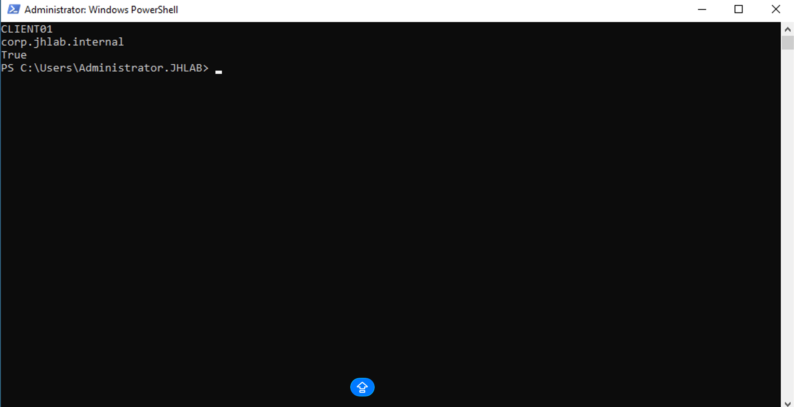
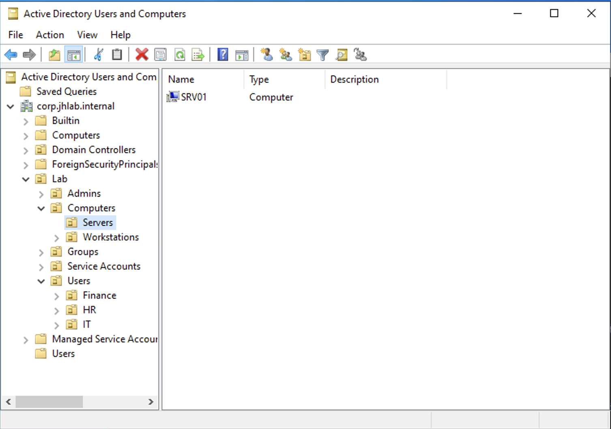
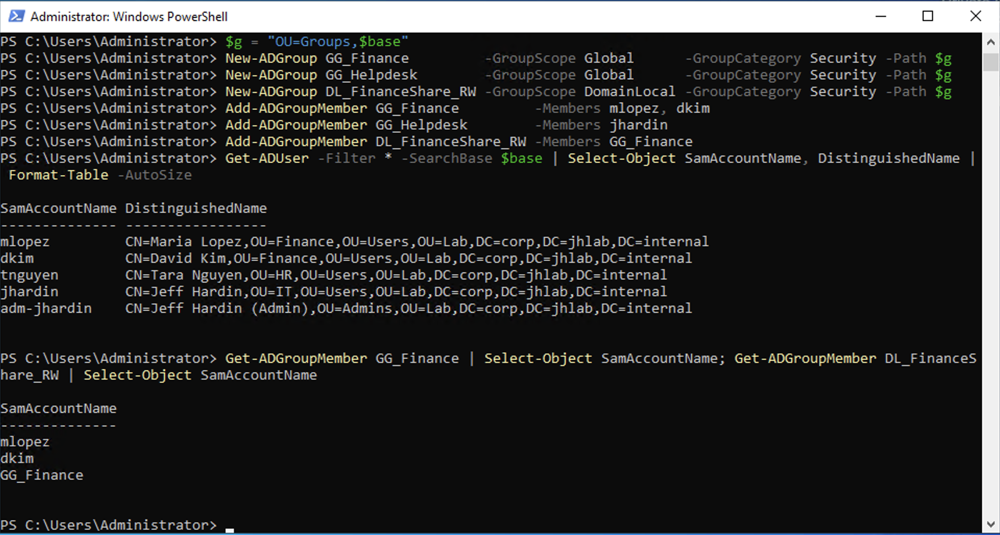
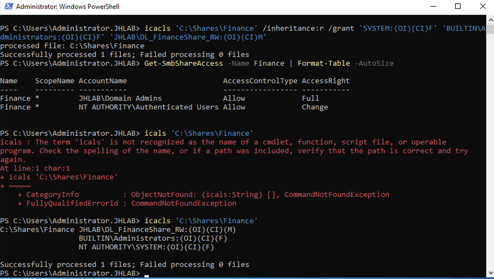
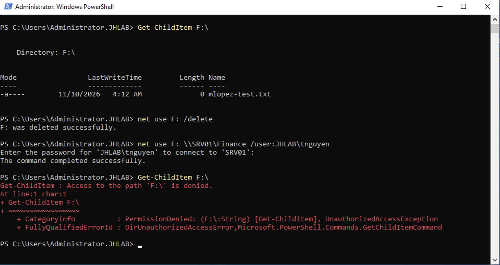

# Phase 2: Join members, build OUs, users, groups and a secured share

**Result:** SRV01 (10.10.1.20) and CLIENT01 (10.10.1.50) are members of `corp.jhlab.internal`, objects live in a designed OU tree, and a Finance share is secured with the AGDLP model. A Finance user can write to it and an HR user is denied.

## Steps
1. Created a VPC DHCP option set (`corp.jhlab.internal`, DNS 10.10.1.10) so members use DC01 for DNS from first boot.
2. Verified each member resolved the domain through DC01 before joining.
3. Joined SRV01 and CLIENT01 to the domain and named them.
4. Built an OU tree under `Lab` (Users by department, Groups, Computers split into Servers and Workstations, Service Accounts, Admins) and moved the computers into it. Ran `redircmp` so future joins land in Workstations.
5. Created four users, a separate admin account (`adm-jhardin`), and AGDLP groups: `GG_Finance` (global) nested in `DL_FinanceShare_RW` (domain local).
6. Created `\\SRV01\Finance` with broad share permissions and restrictive NTFS permissions: inheritance removed, SYSTEM and Administrators Full, `DL_FinanceShare_RW` Modify.

## Verification
- `Test-ComputerSecureChannel` returned True on both members
- `Get-ADComputer` shows DC01, SRV01 and CLIENT01 with no stale objects
- mlopez (Finance) mapped the share and created a file
- tnguyen (HR) mapped the share but was denied at NTFS: `Access to the path 'F:\' is denied`

## Issues investigated
**Join succeeded but rename failed.** `Add-Computer -NewName` on SRV01 returned: *"was successfully joined to the new domain 'corp.jhlab.internal', but renaming it to 'SRV01' failed with the following error message: The directory service is busy."* The message showed the join had worked, so I did not rejoin. I restarted to complete the join, then renamed with `Rename-Computer -DomainCredential`, which also renamed the AD computer object. For CLIENT01 I renamed first and joined second, which avoided the issue. `Get-ADComputer` confirmed no stale `EC2AMAZ-` object remained.

**Credentials failed after the join.** RDP rejected a bare `Administrator` login. On a domain member that name is ambiguous, so I qualified the account: `.\Administrator` for the local account before the join, `JHLAB\Administrator` after it.

**Passwords set with Caps Lock on.** I noticed Caps Lock was on when setting initial passwords, so I reset all five accounts to known values with `Set-ADAccountPassword -Reset` before testing, rather than troubleshooting sign-in failures later.

## Screenshots

