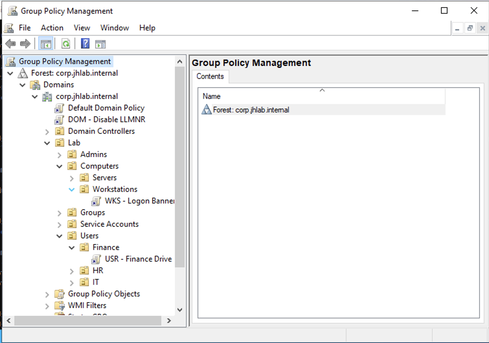
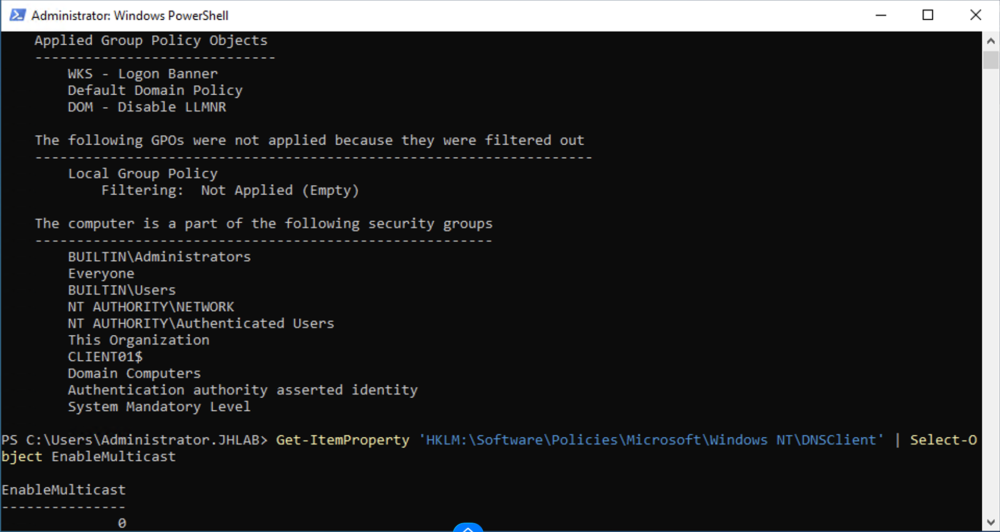
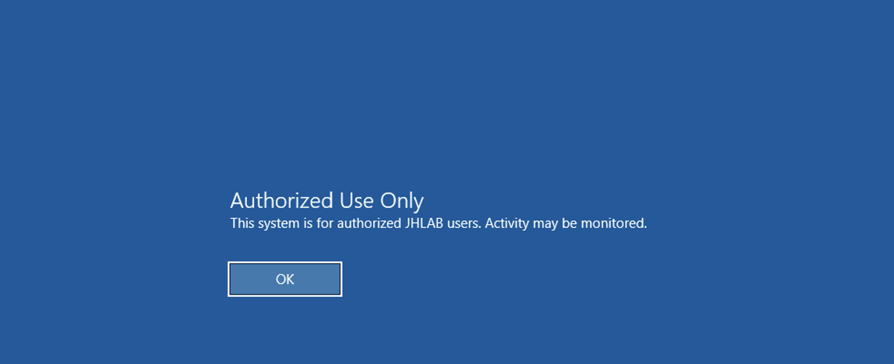
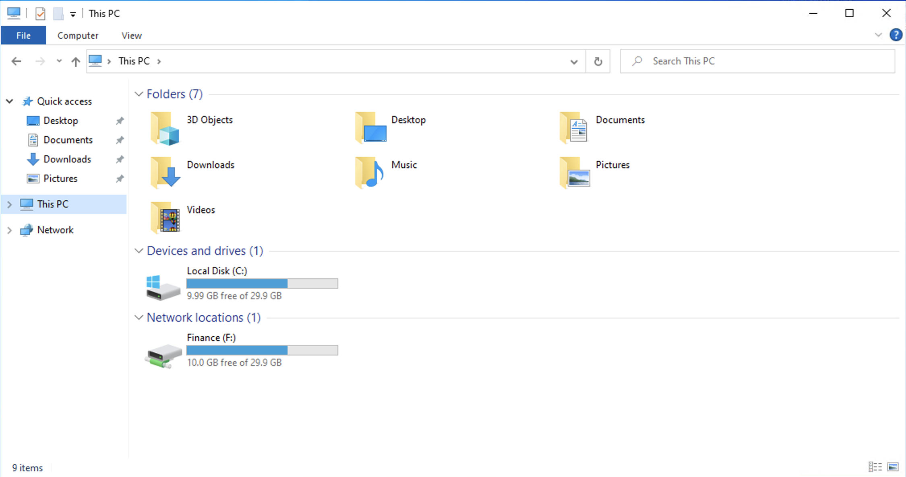
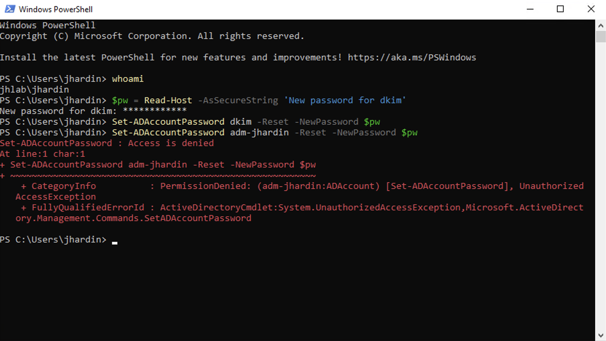

# Phase 3: Group Policy and delegation

**Result:** Three GPOs are applied at three scopes (domain, workstation OU, user OU), and a help desk group can reset passwords for standard users without being administrators.

## Steps
1. Created an ADMX central store in SYSVOL so every console uses the same templates and they replicate to every DC.
2. **DOM - Disable LLMNR** linked at the domain root: sets `EnableMulticast = 0` to block LLMNR name-resolution poisoning.
3. **WKS - Logon Banner** linked to the Workstations OU: a legal consent banner shown before sign-in.
4. **USR - Finance Drive** linked to the Finance user OU: a Group Policy Preference mapping `F:` to `\\SRV01\Finance` with the Update action.
5. Delegated Reset Password, pwdLastSet and lockoutTime rights on `Lab\Users` to `GG_Helpdesk` with `dsacls`, scoped to user objects only.

## Verification
- `gpresult /r /scope computer` on CLIENT01 listed all three computer-scope GPOs; SRV01 listed only the two domain GPOs, confirming OU targeting
- Registry on CLIENT01 showed `EnableMulticast = 0` and the banner text
- The banner appeared at sign-in on CLIENT01
- mlopez (Finance OU) signed in and received `F:` automatically
- jhardin (help desk) reset a Finance user's password from CLIENT01 without elevation; the same command against `adm-jhardin` returned `Access is denied`

## Issues investigated
**Ran checks on the wrong server.** My first `gpresult` came from SRV01, not CLIENT01: the security groups listed `SRV01$`. I used it as evidence instead of discarding it: SRV01 received the domain GPOs but not the workstation banner, which proved OU scoping. I also reverted a Remote Desktop Users change that ran there by mistake, to keep server access limited to admins. Since then I run `hostname` before any change.

**UAC prompt during the delegation test.** Opening PowerShell as administrator from the help desk account triggered a UAC credentials prompt. I declined it and used a normal PowerShell window, because elevating with admin credentials would have made the test prove nothing about the delegated rights.

## Screenshots

