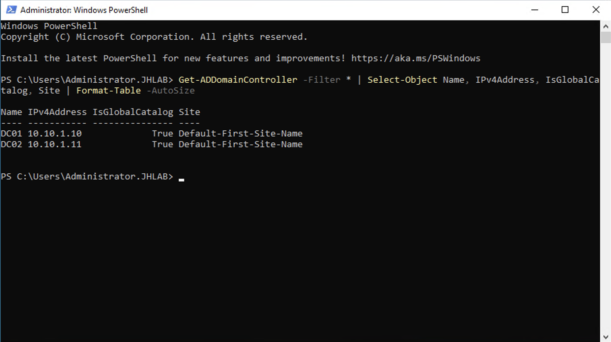
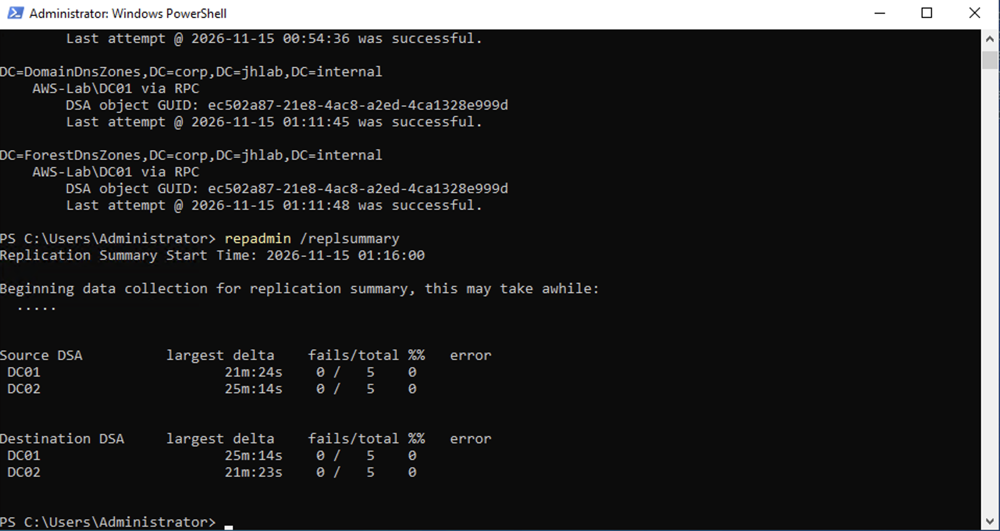
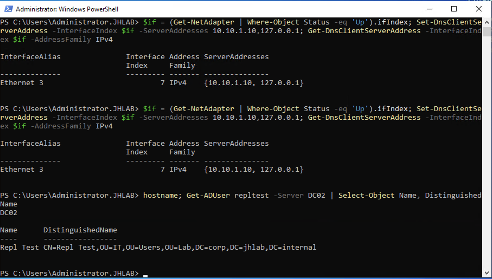
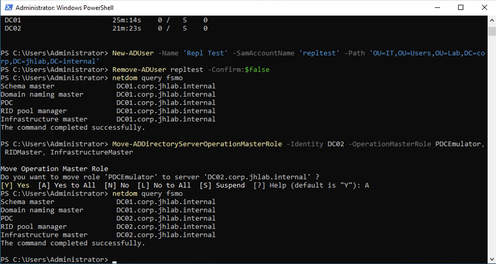

# Phase 4: Second domain controller, replication and FSMO roles

**Result:** DC02 (10.10.1.11) is a second domain controller with DNS and global catalog. Replication is healthy in both directions, and the three domain-wide FSMO roles have moved to DC02.

## Steps
1. Took AMIs of all instances before adding the second DC as a rollback point.
2. Launched DC02, renamed it, set a static IP, and pointed its DNS at DC01 so it could find the domain.
3. Promoted DC02 with `Install-ADDSDomainController`, which joined it to the domain, installed DNS and replicated the full directory from DC01.
4. Cross-pointed DNS on the DCs (each uses its partner first, then loopback) and created a new VPC DHCP option set so members receive both DCs as DNS servers.
5. Renamed the default site to `AWS-Lab` and linked the `10.10.1.0/24` subnet to it.
6. Transferred PDC Emulator, RID Master and Infrastructure Master to DC02; DC01 kept Schema Master and Domain Naming Master.
7. Moved the authoritative time source to the new PDC emulator (DC02 syncs to Amazon Time Sync; DC01 follows the domain hierarchy).
8. Took a matched set of AMIs of all four instances while they were stopped, to avoid USN rollback on restore.

## Verification
- `Get-ADDomainController` lists DC01 and DC02, both global catalogs
- `repadmin /showrepl DC02` shows all five partitions replicating successfully from DC01
- `repadmin /replsummary` shows 0 failures in both directions
- A user created on DC01 was returned by `Get-ADUser -Server DC02` within seconds, and its deletion replicated the same way
- `netdom query fsmo` shows the domain-wide roles on DC02
- `w32tm /query /source` returns 169.254.169.123 on DC02 and DC02 on DC01

## Issues investigated
**Invalid DNS entry in the DHCP option set.** While creating the option set I typed "Custom," into the domain name servers field, which only accepts IP addresses. I corrected it to `10.10.1.10, 10.10.1.11` and verified the values on the option set before renewing leases, since a bad option set would leave members unable to locate a domain controller.

**VPC showed no DHCP option set after saving.** The VPC details still showed "–" after a successful save. The details panel had not refreshed; I confirmed the association by checking the option set itself rather than assuming the save had failed.

**Interpreting replication delta.** `repadmin /replsummary` reported a largest delta of over 20 minutes with zero failures. Within a single site, replication is triggered by change notification, so the delta grows when nothing changes. I treated it as healthy because there were no failures.

## Screenshots

