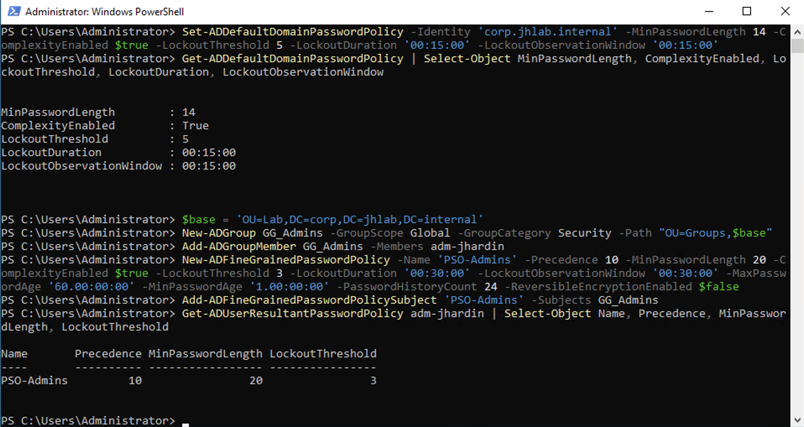
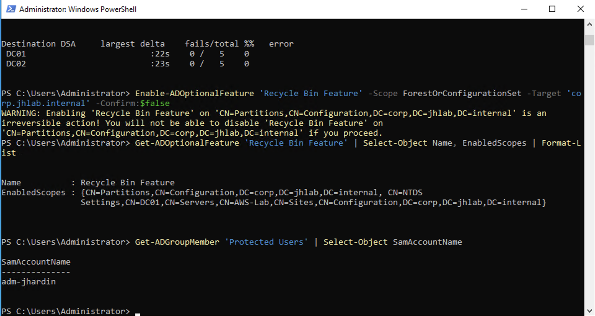
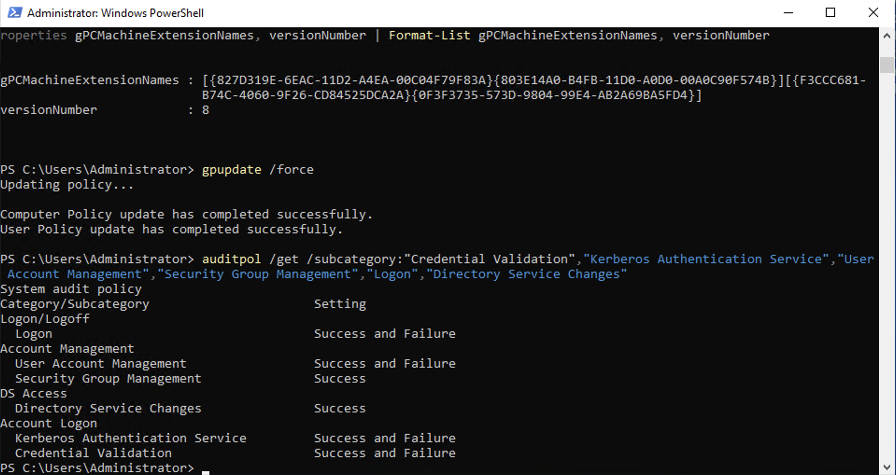
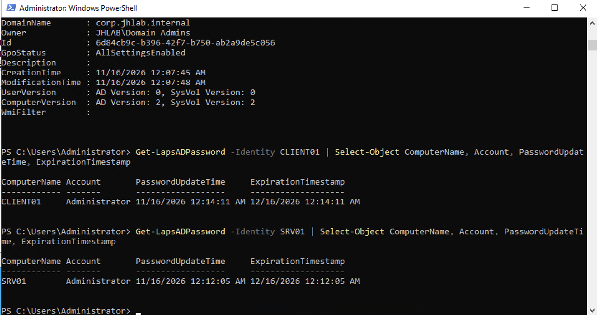

# Phase 5: Password policies, auditing and LAPS

**Result:** The domain enforces password and lockout policies with a stricter policy for admins, admin credentials are hardened with Protected Users, deleted objects can be restored from the AD Recycle Bin, both DCs record key security events with advanced auditing, and member servers have unique rotating local administrator passwords through Windows LAPS. This state is the golden baseline for the break/fix scenarios.

## Steps
1. Set the domain password policy: 14-character minimum, complexity, lockout after 5 failed attempts for 15 minutes.
2. Created a fine-grained password policy (`PSO-Admins`, precedence 10) for admin accounts: 20-character minimum, lockout after 3 attempts, 24-password history, linked to the `GG_Admins` global group.
3. Added `adm-jhardin` to Protected Users to block NTLM, weak Kerberos encryption and credential caching.
4. Enabled the AD Recycle Bin.
5. Created `DC - Advanced Audit`, linked to the Domain Controllers OU: Credential Validation, Kerberos Authentication Service, User Account Management, Logon (success and failure), plus Security Group Management and Directory Service Changes (success).
6. Deployed Windows LAPS: extended the schema, granted computers permission to update their own password, and linked `WKS - LAPS` to `Lab\Computers` (back up to AD, 15-character passwords).
7. Stopped all four instances and imaged them together as the golden baseline.

## Verification
- `Get-ADDefaultDomainPasswordPolicy` and `Get-ADUserResultantPasswordPolicy adm-jhardin` show the expected settings
- Protected Users lists `adm-jhardin`; Recycle Bin `EnabledScopes` is populated
- `auditpol` on DC01 and DC02 shows the configured subcategories
- `Get-LapsADPassword` shows a current password and a 30-day expiration for SRV01 and CLIENT01

## Issues investigated
**Recycle Bin failed with an FSMO ownership error.** `Enable-ADOptionalFeature` returned "The FSMO role ownership could not be verified because its directory partition has not replicated successfully with at least one replication partner." After a restart, a DC will not act on its FSMO roles until it completes initial synchronization with a partner. The DCs had been started together and had not replicated yet. I forced replication with `repadmin /syncall /AdeP`, confirmed zero failures with `repadmin /replsummary`, and the feature enabled on retry.

**Advanced audit policy did not apply.** `gpresult` listed the audit GPO on both DCs, but `auditpol` showed No Auditing. I worked through the chain:
- `audit.csv` existed in the GPO's SYSVOL folder with the correct settings, and on each DC's local SYSVOL.
- GPMC edits on the PDC Emulator by default (DC02), so I confirmed the file had replicated through DFSR before ruling it out.
- The GPO's `gPCMachineExtensionNames` attribute in AD listed only the Security Settings extension, not the Audit Policy Configuration extension `{F3CCC681-B74C-4060-9F26-CD84525DCA2A}`. Clients never ran the audit extension, so the file was never read.
- Re-saving a setting in the editor registered the extension (GPO version 6 to 8). After replication and `gpupdate`, both DCs applied the policy.

## Screenshots

